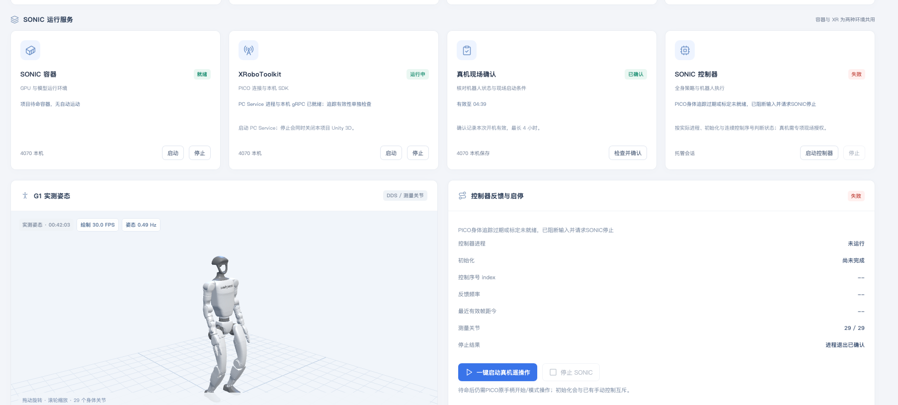

# SONIC 四键启动后失败

记录日期为 2026-11-13，Asia/Shanghai。本轮已完成 PICO 接入、托管输入限频修复、实际仿真验证及30秒真机站立策略复测。身体跟随真机验收尚未完成；用户随后要求退出。下文保留最初失败证据。

## 2026-11-13 17:04 接续调试结果（Asia/Shanghai）

- G1 有线网卡为 `eno1`、地址 `192.168.123.100`。`.161`、`.164` 各 3 次 ping 均无丢包；3 秒只读预检取得 247 个有效 HG LowState 样本、29 个关节，来源唯一、`mode_machine=5`、运动服务登记为 `ai`、无外部 `rt/lowcmd` 发布者。电量为 93%。这些读数不代替现场静止或支撑确认。
- PICO 最初只有长期不更新的旧连接。通过项目入口重启 XR 接收服务并恢复只读订阅器后建立新连接；调整头显 Tracking 与 Send 设置后，身体帧持续更新。设置为 Head/Controller 开启、Motion Tracker=Full body、两只脚踝追踪器完成标定、Send 开启、**Switch w/ A Button 关闭**。Remote Vision 保持关闭；它属于独立视频接收功能。
- 官方 `Switch w/ A Button` 会让右手 A 切换 Send，与 SONIC 的 ABXY/AX 操作存在冲突。原始失败瞬间未记录该开关，不能据此断言旧故障的唯一根因；本轮关闭后四键操作未导致追踪中断。
- 另在隔离输入测试中观察到 Manager 待机状态消息过密：收到数千条/秒状态，进入 PLANNER 后未收到一次性 command。给托管 Manager 主循环按 `target_fps` 限频，保留独立运行路径；使用生产接收参数 HWM=20、每轮最多30包复测，收到 `start=1, stop=0, planner=1`，随后约12秒取得232条planner消息，身体追踪最大观测年龄0.218秒。
- 已增加停止前追踪状态和最近100次观测的内存快照；先请求停止，再写 `tracking_failure.json`，不由诊断落盘延迟停止。退出清理不会覆盖该证据。保留原500ms追踪门槛。
- 修正旧SDK子进程测试的隔离：editable模块查找器曾越过PYTHONPATH假模块，误加载实际SDK；改为启动时明确载入测试夹具。相关9项PICO测试及19项SONIC测试通过；安装器升级、幂等和拒绝未知修改检查通过。
- 实际 C++ TensorRT + MuJoCo + 真实PICO仿真会话 `16c3d0e797f94b519f22a3035bce3be1`，DDS仅`lo`、输入/反馈`15556/15557`。累计接受2656帧、控制序号0至2655、约50Hz，进入POSE身体跟随后保持约15秒有效控制反馈，无故障，正常停止与进程退出确认。用户确认两只脚踝追踪器已完成标定后保存仿真标定确认。
- 本轮Manager SHA-256：`0875560325f78c08eece751f6c5baf0a974c8e51e5c308d0d557adae591cdbc6`。旧源备份于SONIC项目`.local-backups/station-manager-tracking-20261113-085704/`；工作台改动前备份位于`.local-backups/sonic-tracking-evidence-20261113-084555/`。
- 仿真检查不能替代真机初始化、停止效果与身体跟随验收。用户随后要求逐步真机复测；开始前仍按现有现场确认流程核验，未延长或绕过旧授权。

本轮隔离日志在运行目录 `449909ead14b4d59a95f2366fa65340f`，仿真日志和结果在运行目录 `16c3d0e797f94b519f22a3035bce3be1`，均位于 `apps/.runtime/console/sonic-control/runs/`。

参考：[SONIC PICO设置](https://nvlabs.github.io/GR00T-WholeBodyControl/getting_started/vr_teleop_setup.html#connect-xrobotoolkit)、[XRoboToolkit按钮说明](https://github.com/XR-Robotics/XRoboToolkit-Unity-Client#pose-sync-between-xr-device-and-robot-pc)。

## 2026-11-13 17:18 真机复测及退出

- 经用户明确确认现场条件、允许默认站姿和手部初始化后，通过现有 commissioning 流程重新核验并保存本次授权，未绕过现场门槛。现场报告初始化后的站姿和手部正常。
- 第一次真机会话 `b257b1885e934b158f5c96538064064f`：ABXY启动成功，接受807帧、约50Hz，启动16.245秒后触发 `sonic_tracking_lost`。保存的快照显示身体帧年龄0.516887秒、SDK心跳年龄0.012888秒、Manager消息年龄0.020359秒、标定仍有效，C++反馈仍有效。正常停止和退出确认。用户确认当时曾取下或移动头显回复消息；这与身体帧暂停现象吻合，不能用接收器心跳代替身体帧新鲜度。
- 第二次真机会话 `9f347aa920f44d5486fd07507cb968cd`：约定全程佩戴头显，ABXY后连续运行约30秒，接受1510帧、控制序号0至1509、约50Hz、无故障，按约定正常停止并确认退出。用户确认本轮只按了四键，未按A+X；日志仅PLANNER，因此**尚未验收真机POSE身体跟随**。
- 用户随后要求全部退出，已停止SONIC相关会话、仿真/Manager、只读探针、项目XR服务及`sonic-4070`容器，准备断开本次两个SSH会话。没有继续启动真机、行走或重试身体跟随。保留本次代码改动、备份及运行日志。
- 后续复测时，头显佩戴者在策略运行期间保持XRoboToolkit前台和有效身体追踪，消息回复由同伴处理或待停止后进行；不得通过放宽500ms门槛掩盖追踪暂停。

## 复现过程

1. PICO 的 XRoboToolkit 连接 4070，并发送身体姿态。
2. 网页完成单勾选的真机现场确认，启动 SONIC 控制器。
3. 页面显示 PICO 已就绪，等待手柄开始或模式操作。
4. 同时按 A+B+X+Y，页面随即从就绪转为失败。

预期四键操作启用策略，随后可通过 A+X 进入身体跟随。当前真机策略启动与身体跟随验收仍待完成。

## 最新失败证据

- 真机会话为 `a4e12c06a3f94186a37b979647e16b81`。最终状态记录于 2026-11-13 01:03:16.487 +08:00。
- 故障码为 `sonic_tracking_lost`，页面提示“PICO身体追踪过期或标定未就绪，已阻断输入并请求SONIC停止”。
- Manager 日志包含 `Calibration completed (zero-pose reference)` 和 `StreamMode switch: OFF -> PLANNER`，确认四键操作已被识别。
- C++ 日志包含 `Init Done`、`Stop` 和 `Program exiting normally`。最终状态为 `controller_running=false`、`stop_confirmed=true`、`controller_exit_confirmed=true`。
- 有效控制反馈累计为 0，`control_index=null`。此轮没有获得持续递增的 G1 策略反馈。
- 会话退出后，被动接收器再次显示 `body_ready=true`、`calibration_confirmed=true`，身体时间戳继续更新。
- 清理阶段会将 `pico_tracking.json` 写回未就绪，并覆盖先前的观测字段。现存文件记录了退出后的状态，故障触发瞬间的追踪年龄和校验结果仍需补充采样。

[最新状态、关键日志与部署 SHA-256](references/sonic-startup-20261113/latest-failure.json)

## 已实施的修改与验证

- 修复 XR SDK 身体时间戳兼容问题。完整身体包缺少独立身体时间戳时，使用其父包时间戳。
- 复现过多个 SDK 读取端争用同一数据流，已增加跨真机和仿真视图的 SDK 所有权交接与进程锁。
- 最新托管方案由独立 SDK 子进程接收真实身体与手柄输入，通过私有本机套接字供 Manager 使用，追踪健康信息单独写入会话状态文件。
- 已要求 Manager 输入流初始化后再报告控制输入就绪，并调整首次策略开始前的输入流超时判断。
- 已修复快速重启时端口探测受 TIME_WAIT 影响的问题，真实监听端口仍会阻止重复启动。
- 已实现单次现场勾选确认。机器人静止由现场操作者判断，SDK 反馈、唯一来源与接管检查继续执行。
- 最新 66 项后端测试通过，前端 25 项测试通过。独立接收实测连续 15 秒通过，取得 151 次新鲜状态更新、146 个递增身体时间戳，最大观测年龄为 0.183 秒。
- 用户随后进行真机四键复测，仍触发同一故障。独立接收验证与上述测试结果仅覆盖对应检查范围，真机启动故障保持未解决状态。

## 根因状态与后续入口

直接停止原因已定位到 worker 的追踪门控。此前发现的主循环阻塞和初始化期间状态延迟已做修改，最新复测仍失败，最终根因继续待查。

后续需要关联四键操作、SDK 子进程的实际收帧、追踪状态文件的更新时间、Manager 输入消息和 worker 作出停止判断的瞬间。优先保留停止前的状态快照，再分析身体时间戳是否中断、校验是否失败、子进程是否退出，以及状态文件读写或清理是否影响判定。

关键源码包括 `backend/console_sonic_worker.py`、`backend/console_probe_worker.py`、`backend/console_pico.py`、`integrations/sonic/station_tracking.py` 和 `integrations/sonic/install_controller_input.py`。

4070 的应用目录为 `/home/harry/workspace/robot_station/apps`，本地 `backend/` 文件部署到该目录。SONIC 目录为 `/home/harry/workspace/sonic_deploy`。本次完整远端运行日志保留在应用目录的 `.runtime/console/sonic-control/runs/a4e12c06a3f94186a37b979647e16b81/`。

PICO 通过 4070 的 Wi-Fi 接入 XR PC Service，端口为 63901。本机 SDK gRPC 端口为 60061，真机 SONIC 输入和反馈端口分别为 5556、5557，仿真分别为 15556、15557。4070 通过 `eno1` 与 G1 通信。
